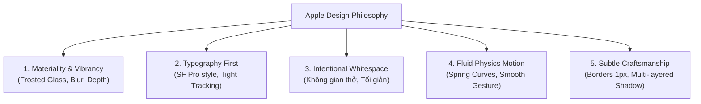
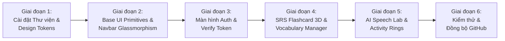

# 🍏 Kế Hoạch Cải Tổ Toàn Diện Giao Diện Frontend (Apple Design Standard)

> **Mục tiêu**: Lột xác toàn bộ giao diện Web từ trạng thái "nguyên mẫu AI với inline-style cứng nhắc" thành một sản phẩm học ngoại ngữ mang ngôn ngữ thiết kế **Apple Human Interface Guidelines (HIG)**: tối giản, tinh tế, sang trọng, tương tác vật lý mượt mà và trực quan đẳng cấp thế giới.

---

## 1. Đánh Giá Hiện Trạng & Vấn Đề Giao Diện (Current State Audit)

### 1.1. Các vấn đề khiến giao diện hiện tại "trông rất AI và thô":
- **Kiến trúc Monolith kềnh càng**: File [`App.tsx`](file:///Users/trustwow/Desktop/Entertainment/English%20Learning%20Web/repos/english-learning-frontend/src/App.tsx) dài hơn 1,100 dòng chứa toàn bộ logic, state và layout giao diện của 5 tính năng khác nhau.
- **Lạm dụng Inline Styles**: 100% phần tử đều dùng `style={{ ... }}` với các mã màu hex bị gắn chết (`#0f172a`, `#1e293b`, `#334155`, `#4f46e5`). Đây là bảng màu "mặc định của AI" (Tailwind dark template rẻ tiền), thiếu chiều sâu và cảm giác cao cấp.
- **Thiếu hệ thống phân cấp thị giác (Visual Hierarchy)**: Kích thước chữ, khoảng cách đệm (padding/margin) không tuân theo tỷ lệ chuẩn, tạo cảm giác chật chội và rối mắt.
- **Không có chuyển động tương tác (Motion & Micro-interactions)**: Thao tác lật thẻ flashcard, chuyển tab, mở modal đều bị giật cục, thiếu độ nảy (spring physics) đặc trưng của Apple.
- **Trải nghiệm xác thực thô sơ**: Chưa có luồng OTP/Token mượt mà, thiếu các chỉ dẫn trực quan cho người dùng.

---

## 2. Ngôn Ngữ Thiết Kế Apple (Apple Design System Blueprint)



### 2.1. Màu sắc & Chất liệu (Materials & Colors)
- **Chế độ Sáng (Light Mode - Apple Clean White)**:
  - Nền trang: `#fbfbfd` (Màu trắng ngọc trai đặc trưng của Apple Store/iOS).
  - Khung nội dung (Cards): `rgba(255, 255, 255, 0.8)` kết hợp `backdrop-blur-xl`.
  - Viền phân cách (Borders): `1px solid rgba(0, 0, 0, 0.06)` siêu thanh mảnh.
  - Chữ chính: `#1d1d1f`, chữ phụ: `#86868b`.
- **Chế độ Tối (Dark Mode - Apple Obsidian)**:
  - Nền trang: `#000000` hoặc `#0d0d0e`.
  - Khung nội dung: `rgba(28, 28, 30, 0.65)` kết hợp `backdrop-blur-2xl`.
  - Viền phân cách: `1px solid rgba(255, 255, 255, 0.08)`.
  - Chữ chính: `#f5f5f7`, chữ phụ: `#a1a1a6`.
- **Hệ màu điểm xuyết (Apple Accent Colors)**:
  - **Apple Blue**: `#0071e3` (Chính / Primary Action).
  - **Emerald Green**: `#34c759` (Thành công / SRS Easy).
  - **Muted Amber**: `#ff9500` (Cảnh báo / SRS Medium).
  - **Soft Coral/Red**: `#ff3b30` (Lỗi / SRS Again).
  - **Indigo Purple**: `#5856d6` (AI & Gamification).

### 2.2. Nghệ thuật Typography
- **Font Stack**: `-apple-system, BlinkMacSystemFont, "SF Pro Display", "SF Pro Text", "Inter", sans-serif`.
- **Letter Spacing**: `-0.022em` cho tiêu đề lớn (tạo cảm giác chặt chẽ, hiện đại), `-0.011em` cho nội dung văn bản.
- **Cỡ chữ theo tỷ lệ vàng**:
  - Hero Header: `font-semibold text-4xl lg:text-5xl tracking-tight`.
  - Section Title: `font-medium text-2xl tracking-tight`.
  - Body Text: `text-[15px] leading-relaxed`.
  - Footnote / Metadata: `text-[13px] text-[#86868b]`.

### 2.3. Hiệu ứng chiều sâu & Đổ bóng (Layered Lighting)
- Thay thế box-shadow thô kệch bằng hiệu ứng bóng 2 lớp tinh tế:
  ```css
  box-shadow: 0 2px 4px rgba(0, 0, 0, 0.02), 
              0 12px 24px -4px rgba(0, 0, 0, 0.06);
  ```

---

## 3. Kiến Trúc Mã Nguồn Sau Khi Tái Cấu Trúc (Modular Architecture)

Chia tách file monolithic [`App.tsx`](file:///Users/trustwow/Desktop/Entertainment/English%20Learning%20Web/repos/english-learning-frontend/src/App.tsx) thành cấu trúc component chuẩn mực:

```
repos/english-learning-frontend/src/
├── components/
│   ├── layout/
│   │   ├── NavigationBar.tsx       # Thanh điều hướng nổi mờ (Glassmorphism Header)
│   │   ├── SegmentControl.tsx      # Thanh trượt tab phong cách iOS
│   │   └── Footer.tsx
│   ├── auth/
│   │   ├── AuthModal.tsx           # Modal xác thực (Apple ID card style)
│   │   ├── LoginForm.tsx           # Form đăng nhập với FaceID/Key icon
│   │   ├── RegisterForm.tsx        # Form đăng ký tài khoản
│   │   └── VerifyEmailForm.tsx     # Form nhập token kích hoạt tài khoản
│   ├── review/
│   │   ├── FlashcardDeck.tsx       # Khu vực học lặp lại ngắt quãng (SRS)
│   │   ├── Flashcard3D.tsx         # Thẻ flashcard lật 3D với hiệu ứng bóng vật lý
│   │   └── QualityRatingPills.tsx  # Nút đánh giá SuperMemo-2 dạng viên thuốc (Pill)
│   ├── vocabulary/
│   │   ├── VocabularyExplorer.tsx  # Quản lý từ vựng phong cách Apple Notes
│   │   ├── WordDetailDrawer.tsx    # Slide-over chi tiết từ vựng
│   │   └── AddWordDialog.tsx       # Dialog thêm từ mới
│   ├── ai/
│   │   ├── AiTutorLab.tsx          # Không gian gia sư AI
│   │   ├── VoiceWaveVisualizer.tsx # Sóng âm thanh động khi thu âm phát âm
│   │   └── PronunciationScore.tsx  # Vòng tròn điểm số phát âm chi tiết
│   ├── test/
│   │   ├── TestSessionView.tsx     # Giao diện làm bài thi trắc nghiệm CEFR
│   │   ├── CountdownPill.tsx       # Đồng hồ đếm ngược phong cách Dynamic Island
│   │   └── TestResultCard.tsx      # Thẻ kết quả thi và phân tích kỹ năng
│   ├── profile/
│   │   ├── ProfileOverview.tsx     # Trang cá nhân
│   │   ├── ActivityRings.tsx       # Vòng tròn hoàn thành mục tiêu (Apple Fitness Style)
│   │   └── ActiveSessionsList.tsx  # Danh sách thiết bị đăng nhập bảo mật
│   └── ui/                         # Base Apple-styled UI primitives
│       ├── Button.tsx
│       ├── Card.tsx
│       ├── Input.tsx
│       ├── Badge.tsx
│       ├── Dialog.tsx
│       └── RingProgress.tsx
├── context/
│   └── AuthContext.tsx
├── services/
│   └── api.ts
├── styles/
│   └── globals.css                 # Apple typography, utility classes & animations
└── App.tsx                         # Router & Orchestrator sạch sẽ (<150 dòng)
```

---

## 4. Chi Tiết Trải Nghiệm Các Màn Hình Tính Năng (Feature Experience Design)

### 4.1. Navigation Bar & Segment Control (Thanh điều hướng đỉnh cao)
- **Kiểu dáng**: Nổi lơ lửng ở đỉnh trang với hiệu ứng kính mờ `backdrop-blur-md bg-white/70 dark:bg-black/70 border-b border-black/[0.06]`.
- **Segmented Control Tabs**: Thiết kế chuẩn Apple macOS/iOS – một thanh nền xám nhạt với "viên thuốc trượt" (sliding pill) chuyển động êm ái khi người dùng đổi tab (Review, Từ vựng, AI Tutor, Kiểm tra, Cá nhân).
- **Profile Pill**: Hiển thị avatar tròn, cấp độ CEFR hiện tại (ví dụ: `B2`), và số ngày học liên tục (Streak Counter) với biểu tượng lửa nhẹ nhàng.

### 4.2. Thẻ Flashcard SRS (3D Card & Sound Feedback)
- **Mặt trước (Front)**:
  - Từ vựng to đậm (`text-4xl font-semibold tracking-tight`).
  - Phiên âm IPA màu xám thanh lịch, nút loa phát âm âm thanh chất lượng cao.
  - Nhãn phân loại từ loại (Noun, Verb, Adj) dạng badge tinh tế.
- **Cơ chế lật 3D**:
  - Dùng CSS 3D transforms (`rotateY`) kết hợp Framer Motion `spring` (stiffness: 300, damping: 25) tạo cảm giác như cầm thẻ bài thật.
- **Mặt sau (Back)**:
  - Nghĩa tiếng Việt, định nghĩa Anh ngữ, câu ví dụ có bôi đậm từ khóa.
- **Hàng nút xếp hạng SM-2 (Quality Rating)**:
  - 4 nút bấm bo góc hình viên thuốc (Pill): *Blackout (0)*, *Hard (2)*, *Good (4)*, *Master (5)* với màu sắc dịu mắt, có hiệu ứng haptic khi nhấp chuột.

### 4.3. AI Tutor & Phát Âm (Apple Siri / Waveform Vibe)
- Nhập từ vựng cần phân tích: AI trả về từ đồng nghĩa, phân tích ngữ cảnh, và câu hỏi trắc nghiệm tự động.
- **Pronunciation Assessment**:
  - Nút thu âm dạng vòng tròn phát sáng pulsing.
  - Visualization sóng âm thời gian thực.
  - Phân tích điểm theo 3 tiêu chí: *Accuracy*, *Fluency*, *Completeness* hiển thị bằng vòng tròn chỉ số sắc nét.

### 4.4. Trang Cá Nhân & Vòng Hoạt Động (Apple Fitness Activity Rings)
- Thay thế các thanh tiến độ phẳng đơn điệu bằng **3 vòng tròn hoạt động (Activity Rings)**:
  1. **Vòng 1 (Đỏ cam)**: Số phút học trong ngày (Daily Goal Minutes).
  2. **Vòng 2 (Xanh lục)**: Số thẻ từ đã ôn tập (Due Reviews Completed).
  3. **Vòng 3 (Xanh dương)**: Điểm kiểm tra hoặc phát âm trung bình.
- Quản lý phiên đăng nhập: Thẻ danh sách hiển thị icon thiết bị (Mac, iPhone, Chrome), địa chỉ IP, trạng thái bảo mật hiện hành.

---

## 5. Lộ Trình Triển Khai Chi Tiết (Step-by-Step Implementation Roadmap)



### Bước 1: Chuẩn bị Thư viện & Cấu hình Styles
- Cài đặt các thư viện thiết yếu:
  - `tailwindcss` (hoặc cấu hình utility class tối ưu với PostCSS/Vite).
  - `framer-motion` (động lực học chuyển động Apple spring).
  - `clsx` & `tailwind-merge` (tiện ích hợp nhất class linh hoạt).
  - `canvas-confetti` (hiệu ứng ăn mừng khi hoàn thành vòng học).
- Cấu hình file `globals.css` định nghĩa các biến màu Apple Materiality, hiệu ứng mờ kính `glass-morphism`, và animation keyframes.

### Bước 2: Xây dựng Base UI Primitives
- Tạo các thành phần cốt lõi trong `src/components/ui/`:
  - `Button.tsx`: Các biến thể `primary` (Apple Blue), `secondary` (Soft Gray), `ghost`, `danger`.
  - `Card.tsx`: Lớp nền phủ kính, viền 1px, shadow 2 tầng.
  - `Input.tsx`: Ô nhập liệu bo góc 10px, viền sáng nhẹ khi focus.
  - `SegmentControl.tsx`: Thanh trượt tab Apple chính hiệu.
  - `RingProgress.tsx`: Vòng tròn SVG động cho điểm số và tiến trình.

### Bước 3: Tái thiết kế Navigation Bar & Trải nghiệm Xác thực
- Tạo `NavigationBar.tsx`: Thanh header kính mờ cố định, hiển thị logo, segmented control, và user chip.
- Tạo `AuthModal.tsx`: Thẻ đăng nhập / đăng ký / xác thực email như một tấm thẻ Apple ID sang trọng, có hướng dẫn mở Mailpit một chạm.

### Bước 4: Tái cấu trúc Màn hình Học Flashcard & Từ Vựng
- Tách `FlashcardDeck.tsx` và `Flashcard3D.tsx`: Trải nghiệm lật thẻ mượt mà, hỗ trợ phím tắt bàn phím (Phím Space để lật thẻ, phím 1-4 để chấm điểm).
- Tách `VocabularyExplorer.tsx`: Giao diện danh sách từ vựng sạch sẽ, bộ lọc CEFR tinh tế, thêm từ mới qua drawer trượt mượt mà.

### Bước 5: Hoàn thiện AI Tutor, Test Center & Dashboard Cá nhân
- Tách `AiTutorLab.tsx` với sóng âm thu phát âm.
- Tách `TestSessionView.tsx` với thanh tiến trình thi và kết quả chấm điểm tức thì.
- Tách `ProfileOverview.tsx` với 3 vòng tròn chỉ số Apple Fitness Rings.

### Bước 6: Kiểm thử Responsive, Hiệu năng & Đồng bộ Git
- Kiểm tra hiển thị hoàn hảo trên mọi kích thước màn hình (Mobile iPhone, iPad, Macbook Desktop).
- Chạy `npm run build` để kiểm tra 0 lỗi TypeScript, 0 lỗi CSS.
- Commit và đẩy mã nguồn sạch sẽ lên repository `Learning-English-System/english-learning-frontend`.

---

## 6. Tiêu Chí Nghiệm Thu (Acceptance Criteria)

| Tiêu chí | Trạng thái mong muốn |
| :--- | :--- |
| **Tính thẩm mỹ (Aesthetics)** | Đạt phong cách Apple: nền sáng sạch/tối obsidian, kính mờ Frosted Glass, chữ sắc nét, khoảng thở rộng rãi. |
| **Mã nguồn (Clean Code)** | File `App.tsx` giảm từ 1,100 dòng xuống dưới 150 dòng; chia thành hơn 10 component độc lập trong `src/components/`. |
| **Hiệu ứng chuyển động (Motion)** | Lật thẻ Flashcard 3D tự nhiên, chuyển tab segment control lướt êm ái, modal hiện trơn tru với Framer Motion. |
| **Trải nghiệm xác thực (Auth UX)** | Đầy đủ 3 tab Đăng nhập - Đăng ký - Xác thực email, tích hợp hướng dẫn Mailpit trực quan. |
| **Hiệu năng & Build** | Tốc độ tải dưới 1 giây, `npm run build` thành công hoàn toàn không có bất kỳ warning/lỗi nào. |
